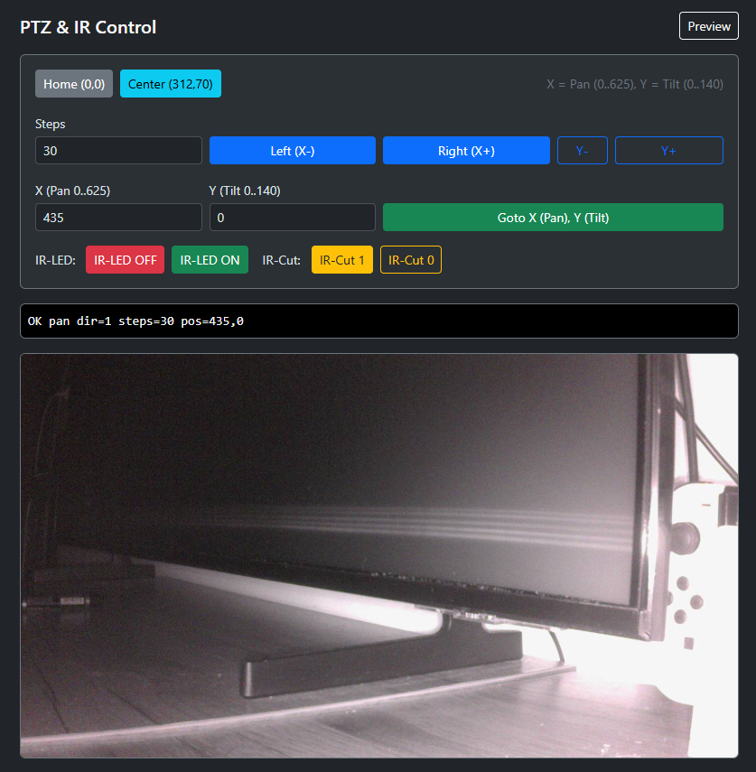

# GRAIN 81XX CAMERA - BLOW 78-701


This IP camera originally relied on an outdated P2P server (`P2PICAMERA.COM`), which is now permanently down.

The goal of this project is to rescue the camera from e-waste and turn it into a simple, reliable, local-only IP camera free of cloud dependencies with working PTZ (Pan-Tilt-Zoom) / IR controls and a live snapshot / MJPEG-style web stream.

To achieve this, I analyzed the system processes and decompiled parts of the original `nvisr` firmware (using Ghidra) to reproduce the hardware controls without relying on `nvisr`.

## Hardware Specifications

| Component | Details |
| :--- | :--- |
| **SoC / CPU** | Grain Media GM8125 |
| **RAM** | 128 MB DDR2 (Samsung) |
| **Storage** | 4 MB SPI Flash + MicroSD card slot |
| **Camera Sensor** | 3 MPx sensor |
| **Networking** | 10/100 Mbps Ethernet + BL-3070-3B WiFi module |
| **PTZ Actuators** | 2x stepper motors (Pan & Tilt) with GPIO limit switches |
| **I/O & Peripherals** | 1x alarm relay, audio out, physical reset button, DC power jack |
| **OS** | Linux A320D 2.6.28 #1285 PREEMPT Thu Dec 25 17:19:45 CST 2014 armv5tel GNU/Linux |
---

## Repository Structure

```text
grain81xx-camera/
├── bins/           # Precompiled ARM binaries (ptz_test, snap)
├── decompile/      # Ghidra decompilation screenshots and reverse-engineering notes
├── flash_dump/     # Full SPI Flash partition dumps (mtd0.bin - mtd5.bin)
├── images/         # Hardware photos, captured sample frames, and web UI preview
├── libs/           # C source code for hardware tools (ptz_test.c, snap.c)
├── sys/            # Original and modified boot scripts + MTD backup (mtd1_backup.bin)
├── tests/          # Experimental scripts and test artifacts
├── web_app/        # Persistent web interface & CGI handlers (index.html, ptz.html, cgi-bin/)
└── passwd          # Extracted system user database
```

---

## Getting Root Shell & Flash Backup

1. **Connect via UART:** Solder jumper wires to the onboard UART (COM) header and connect it to a USB-to-TTL adapter.
2. **Bypass the Watchdog:** The system runs a hardware watchdog (`cpe-wdt.ko`) with a 15-second timeout. Stopping the main application after boot triggers a watchdog reboot, whereas interrupting early or omitting `cpe-wdt.ko` in `boot.sh` keeps a stable root shell.
3. **Crack the Root Password:** Read `/etc/passwd` and `/etc/shadow` (see `passwd`) to extract the root password hash:
   * **DES Hash:** `N.lbMktxdQ76A`
   * **Cracked Password (via `hashcat`):** `GM8182`
4. **Telnet Access:** Port `23` (`telnetd`) is started from `boot.sh` and accepts the root password cracked above.
5. **Backup SPI Flash:** Before modifying `/mnt/mtd`, dump all MTD partitions (`mtd0`–`mtd5`, saved in `flash_dump/` and `sys/mtd1_backup.bin`) so the stock firmware can be restored if needed.

---

## Hardware & Reverse Engineering Notes

* **PTZ & IR Control (`libs/ptz_test.c`):** Pan and tilt use stepper motors driven via `/dev/gpio0` (`ftgpio.ko`) using `ioctl` commands (`2`, `4`, `5`, `6`, `7`, `8`), with GPIO limit switches (`LEFT`, `RIGHT`, `UP`, `DOWN`) and IR outputs (`ircut`, `irled`). Standalone `ptz_test` sets pin directions explicitly (`ioctl` `2` for bank `0`, `ioctl` `6` for bank `1`, including bank `1` pin `13`), and `/mnt/mtd/boot.sh` (`sys/new_mnt_motd_boot.sh`) applies the required pinmux masks on `0x99000050`, `0x99000054`, and `0x99000058` so PTZ and IR work immediately after boot without `nvisr`.
* **Video Capture (`libs/snap.c` & `web_app/cgi-bin/snap.cgi`):** `boot.sh` loads the HM1375 / `videograph` / `dvr_enc` / `fmjpeg_drv` kernel modules without `cpe-wdt.ko` or `nvisr`. Because `snap` fails if the target output file already exists and concurrent calls can trigger `dvr_graph` / rate-control errors, `snap.cgi` writes to a unique temporary file in `/tmp/`, moves it atomically to `/tmp/snap.jpg`, and serializes access using a `/tmp/snap.lock` directory lock.
* **Persistent Web App (`web_app/`):** Static pages and CGI scripts are stored on persistent flash under `/mnt/mtd/opt/www` (`index.html`, `ptz.html`, `cgi-bin/snap.cgi`, `cgi-bin/ptz.cgi`) and served via BusyBox `httpd -h /mnt/mtd/opt/www -p 80` started from `/mnt/mtd/boot.sh`.

---

## Useful Commands

Configure static IP on the camera:

```sh
ip addr add 10.0.12.215/24 dev eth0
ip link set eth0 up
```

Transfer compiled binaries from `bins/` using `netcat`:

```sh
# On the camera:
nc -l -p 9010 > /mnt/mtd/bin/snap && chmod +x /mnt/mtd/bin/snap
nc -l -p 9010 > /mnt/mtd/bin/ptz_test && chmod +x /mnt/mtd/bin/ptz_test

# On the host machine:
nc -N 10.0.12.215 9010 < bins/snap
nc -N 10.0.12.215 9010 < bins/ptz_test
```

---

## Project Roadmap

### Done

* [x] Solder jumper wires to the UART port
* [x] Capture and analyze U-Boot logs
* [x] Dump SPI Flash partitions (`flash_dump/mtd0.bin`–`mtd5.bin`, `sys/mtd1_backup.bin`)
* [x] Extract `/etc/shadow` and crack the DES root password (`GM8182`) with `hashcat`
* [x] Log in via Telnet
* [x] Override `/mnt/mtd/boot.sh` (`sys/new_mnt_motd_boot.sh`) to load video/GPIO drivers, apply pinmux masks (`0x99000050`–`0x99000058`), omit `nvisr` and `cpe-wdt.ko`, and start `httpd`
* [x] Write standalone PTZ & IR control binary (`libs/ptz_test.c` -> `bins/ptz_test`) with pin direction setup (`ioctl` `2` / `6`), bank `1` pin `13`, and limit switch checks (using Ghidra)
* [x] Build `snap` (`libs/snap.c` -> `bins/snap`) to capture JPEG frames and harden `web_app/cgi-bin/snap.cgi` against existing target files and concurrent `dvr_graph` contention (`/tmp/snap.lock`)
* [x] Run a persistent BusyBox `httpd` web app (`web_app/` -> `/mnt/mtd/opt/www`) with client-synchronized snapshot updates (`index.html`, `ptz.html`, `snap.cgi`)
* [x] Make wrapper for `ptz_test` (`web_app/cgi-bin/ptz.cgi` supporting simple `pan`/`tilt`, `ircut`/`irled`, and coordinate `goto` tracking)

### Web APP



### To Do

* [ ] DHCP
* [ ] Get WiFi working
* [ ] Get MicroSD working
* [ ] Get Audio working (not necessary)
* [ ] Clean up SPI Flash (remove manufacturer bloat)
